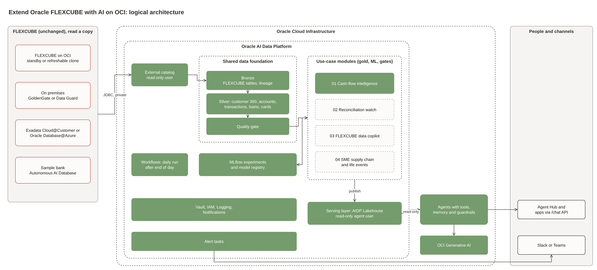
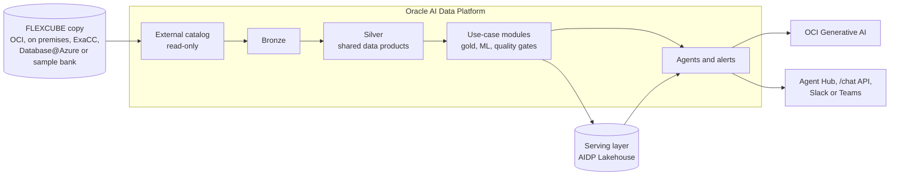

# Extend Oracle FLEXCUBE with AI on OCI

> [!IMPORTANT]
> **Disclaimer: this is a personal playbook, not an Oracle product or official Oracle solution.**
> It was created by Abeer Naffa' in a personal capacity to share a pattern and sample code. It is not supported, endorsed,
> reviewed or warranted by Oracle, and any views in it are the author's own. It is provided "as is", without warranty of any
> kind. You are responsible for testing, securing and adapting it before any use with real data or in production.

Add AI-driven capabilities to Oracle FLEXCUBE Universal Banking **without changing the core**. This repository is the
reference implementation of a proposed reference architecture and playbook: a governed data
foundation on Oracle AI Data Platform (AIDP) over a read-only copy of FLEXCUBE, and use-case modules that plug into it.

The first module, **cash-flow intelligence**, gives relationship managers, collections and risk teams early warning of
distress and attrition, a ranked collections worklist, SME cash-flow runway, an RM copilot and a daily alert, each with
plain-language reasons.

Try it end to end on a **synthetic FLEXCUBE sample bank** (2,000 customers, 34 FLEXCUBE-style tables), then point the same
foundation at a copy of your own FLEXCUBE on OCI, on premises, on Exadata Cloud@Customer or on Oracle Database@Azure.

> All sample data is synthetic. No real customer, account or bank data is included.

## Architecture





Full description, components, recommendations and considerations: [reference architecture](docs/reference-architecture.md).

## Use-case modules

| # | Module | Status | What it delivers |
|---|---|---|---|
| 01 | [Cash-flow intelligence](use-cases/01-cashflow-intelligence/README.md) | **Available** | Early warning (rules and ML), collections worklist, SME runway, RM copilot, daily RM alerts |
| 02 | [Reconciliation watch](use-cases/02-reconciliation-watch/README.md) | Design | Daily break detection on GLs, references and balances |
| 03 | [FLEXCUBE data copilot](use-cases/03-flexcube-data-copilot/README.md) | Design | Governed plain-language questions over curated data products |
| 04 | [SME supply chain and life events](use-cases/04-sme-supply-chain-and-life-events/README.md) | Design | Counterparty concentration and contagion; life-event triggers |

## Deploy

| Step | What | Guide |
|---|---|---|
| 1 | Prerequisites and IAM | [docs/foundation/01_prerequisites_and_iam.md](docs/foundation/01_prerequisites_and_iam.md) |
| 2 | Foundation: network, Vault, AIDP, IAM, logging and the optional sample bank, with Terraform or Resource Manager | [docs/foundation/02_deploy.md](docs/foundation/02_deploy.md) |
| 3 | Connect your FLEXCUBE (or keep the sample bank) | [docs/foundation/03_source_patterns.md](docs/foundation/03_source_patterns.md) |
| 4 | Enable modules | [use-cases/README.md](use-cases/README.md) |
| 5 | Take it to production | [docs/path-to-production](docs/path-to-production/README.md) |

Quick start with the sample bank:

```bash
cd foundation/terraform && terraform init && terraform apply      # or create a Resource Manager stack from this folder
cd ../.. && cp foundation/source/sample-bank/deploy.env.example foundation/source/sample-bank/deploy.env
#   set FROM_TERRAFORM=true in deploy.env
bash foundation/source/sample-bank/deploy_sample_source.sh
# AIDP console: cluster, catalogs, foundation notebooks (docs/foundation/02_deploy.md, steps 3 to 5)
bash foundation/serving/deploy_serving_layer.sh <AIDP Lakehouse OCID>
# then follow use-cases/01-cashflow-intelligence/README.md
```

## Repository map

| Path | What it is |
|---|---|
| [`docs/`](docs) | Reference architecture, foundation guides, path to production |
| [`architecture/`](architecture) | Diagrams (PNG, drawio, Mermaid sources) |
| [`foundation/terraform/`](foundation/terraform) | Terraform and Resource Manager stack for the shared infrastructure |
| [`foundation/source/`](foundation/source) | Sample bank (data, generator, load script) and scripts for your own FLEXCUBE |
| [`foundation/lakehouse/`](foundation/lakehouse) | Bronze, silver and quality-gate notebooks shared by all modules |
| [`foundation/serving/`](foundation/serving) | Serving users and the script that deploys every module's serving tables |
| [`use-cases/`](use-cases) | One folder per module: notebooks, serving SQL, agent specification, playbook |
| [`channels/`](channels) | Delivery channels, such as the Slack bridge for deployed agents |
| [`tests/`](tests), [`tools/`](tools), [`.github/`](.github) | Local pipeline test, notebook build tool, CI |

## Design principles

1. **The core stays untouched.** Read a copy through a least-privilege user; never write to FLEXCUBE.
2. **Interpret FLEXCUBE once.** A shared silver layer turns FLEXCUBE structure into readable data products for every module.
3. **Modules are independent.** Each owns its gold schema, models, serving tables, agent and alerts.
4. **Governed AI.** Agents read only a curated serving layer, read-only, behind guardrails; every output is explainable.
5. **Fair by design.** Protected attributes are never features, rules or rankings.
6. **Everything as code.** Terraform, idempotent scripts, notebooks built from source, tests and CI.

## Contributing and security

- Suggestions and fixes are welcome through issues and pull requests: see [CONTRIBUTING.md](CONTRIBUTING.md) and the
  [module contract](use-cases/README.md#module-contract).
- To report a security concern, see [SECURITY.md](SECURITY.md).

## Disclaimer

- **Not an Oracle product.** This playbook is the author's personal work. It is not an official Oracle solution, reference
  architecture or product, and Oracle does not support, endorse or warrant it.
- **No warranty.** Everything here (code, scripts, Terraform, notebooks, agent specifications, documentation) is provided
  "as is", without warranty of any kind, express or implied, including fitness for a particular purpose. The author is not
  liable for any loss or damage arising from its use.
- **No license granted yet.** No open source license has been applied while the content is under review. You may read it and
  try it for evaluation; please contact the author before reusing or redistributing it.
- **Your responsibility.** Test it in a non-production environment, review it with your security, risk and compliance teams,
  and adapt it to your bank's policies before use with real data. Model outputs are decision support, not credit decisions.
- **Synthetic data only.** The sample bank is fully synthetic. No real customer, account or bank data is included, and none
  should ever be committed to this repository.
- **Costs.** Deploying it creates billable OCI resources in your tenancy. Remove them when you are done.
- **Trademarks.** Oracle, FLEXCUBE, OCI and related names are trademarks of Oracle and/or its affiliates. Other names may be
  trademarks of their respective owners. Their use here does not imply endorsement.

Author: Abeer Naffa'
