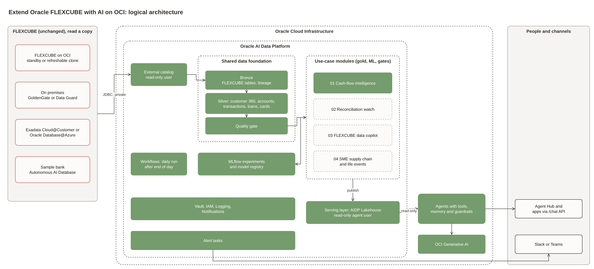
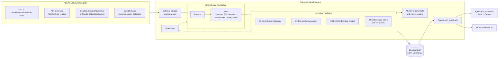
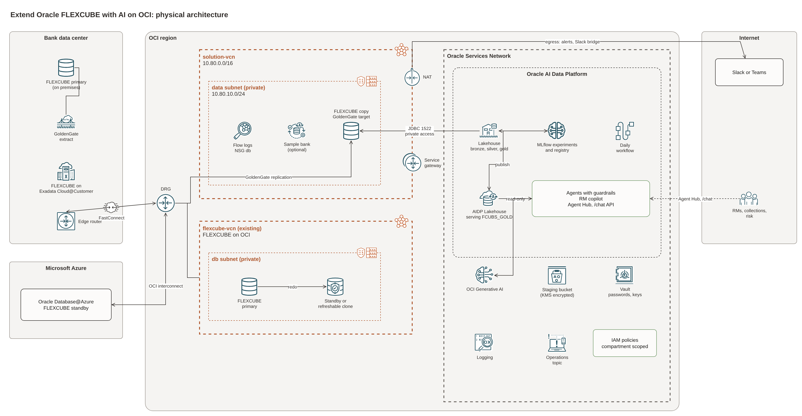

# Extend Oracle FLEXCUBE with AI on OCI

> [!IMPORTANT]
> Personal playbook by Abeer Naffa', proposed for review. Not an official Oracle solution, product or reference architecture,
> and not supported or warranted by Oracle. See the [disclaimer](../README.md#disclaimer).

Banks run Oracle FLEXCUBE Universal Banking as their system of record. The data it holds (customers, accounts, every posting,
loan schedules, card settlements) already describes how each customer and business is doing. Most of that signal stays
unused because changing the core is slow, risky and expensive.

This reference architecture extends FLEXCUBE **without changing it**. A read-only copy of FLEXCUBE data flows into Oracle AI
Data Platform (AIDP) on Oracle Cloud Infrastructure (OCI), where a governed lakehouse, machine learning and AI agents turn it
into insight that relationship managers, risk, collections and operations teams act on. New capabilities arrive as
independent **use-case modules** on one shared foundation, so the second use case costs a fraction of the first.

The first module, **cash-flow intelligence**, gives early warning of customer distress and attrition, a ranked collections
worklist, SME cash-flow runway, a relationship-manager (RM) copilot and a daily alert per RM. It ships with Terraform, scripts,
notebooks, an agent specification and a synthetic FLEXCUBE sample bank, so you can deploy it end to end in a day.

## Architecture

The architecture has four layers:

1. **Source.** FLEXCUBE stays the system of record. AIDP reads a **copy**, never the production primary, through a
   least-privilege database user that can select only the tables each module needs. Four source patterns are supported
   (see [source patterns](foundation/03_source_patterns.md)).
2. **Shared data foundation.** Bronze lands the FLEXCUBE tables as they are, with lineage. Silver conforms them into readable,
   bank-agnostic tables (one customer profile, accounts, categorised transactions, loan status, card spend). Quality checks
   gate every run. Every module builds on silver, so FLEXCUBE structure is interpreted once.
3. **Use-case modules.** Each module owns its gold schema, models, serving tables, agent and alerts, and can be enabled or
   removed on its own. Modules never write to silver or to another module's tables.
4. **Serve and act.** Curated results are published to a serving schema in the AIDP Lakehouse. Agents read only that schema,
   through a read-only user, behind guardrails. People reach them in Agent Hub, through the agent's `/chat` API, or in
   collaboration tools; routine alerts are pushed by workflow tasks.

### Physical architecture

The Terraform foundation deploys this topology in one compartment:

| Component | Configuration | Purpose |
|---|---|---|
| VCN with a private data subnet | NAT gateway, service gateway (all Oracle services), no internet gateway, flow logs | Private path from AIDP to source databases and Oracle services |
| Network security group `db` | SQL*Net 1521 to 1522 and HTTPS from the VCN only | Database private endpoints |
| OCI Vault and master key | Generated passwords for every database user, never in state files you share or in the repository | Secrets management |
| Object Storage bucket | Private, versioned, encrypted with the Vault key | Staging and exports |
| Oracle AI Data Platform | One instance, default workspace, AI features on; creates its own AIDP Lakehouse | Lakehouse, Spark, MLflow, agents, workflows |
| Autonomous AI Database (optional) | Transaction Processing, 2 ECPU, private endpoint or allow list | Synthetic FLEXCUBE sample bank |
| IAM policies | AIDP service statements scoped to the compartment, optional administrator group | Least privilege |
| Logging and Notifications | Log group, subnet flow logs, operations topic with email subscription | Audit and alerting |

Editable drawio versions of both diagrams are in [`architecture/`](../architecture).

### Components

- **Oracle FLEXCUBE Universal Banking** is the core banking system of record. The architecture reads its standard tables and
  needs no core customisation, extension or new batch job.
- **Oracle Data Guard, Autonomous Database refreshable clones and Oracle GoldenGate** keep a read-only copy of FLEXCUBE in step
  with production, so analytics never load the primary.
- **Oracle AI Data Platform** unifies the lakehouse (Delta tables on Object Storage, external catalogs over Oracle databases),
  Apache Spark notebooks, workflows, MLflow experiments and model registry, and AI agents with tools, memory and guardrails.
- **AIDP Lakehouse (Oracle Autonomous AI Lakehouse)** hosts the serving schema that agents and other applications query.
- **OCI Generative AI** provides the large language model behind the agents, on demand, in your region.
- **OCI Vault** stores encryption keys and database secrets.
- **OCI Object Storage** stages data and holds lakehouse files.
- **OCI Identity and Access Management** scopes AIDP to the compartment and the people who administer it.
- **OCI Logging, Monitoring and Notifications** capture flow logs and audit events and alert operations.
- **OCI Resource Manager** deploys the Terraform foundation from the console.

## Recommendations

- **Read a copy, never the primary.** Use a Data Guard standby opened read-only, a refreshable clone, or a GoldenGate
  replica. Schedule the daily pipeline after FLEXCUBE end of day, when the copy is consistent.
- **Least privilege at every hop.** One read-only user on the source with SELECT on the listed tables only; a publisher user
  that writes the serving schema; a read-only agent user. Agents never see bronze, silver or raw FLEXCUBE.
- **Minimise personal data before it leaves the core.** No module needs card numbers, IBANs or national identifiers. Expose
  views or apply Oracle Data Redaction on the copy, and keep names only where people must act on them.
- **Private networking.** Use private endpoints for source and serving databases and AIDP private network access. The
  quick-start public endpoint with an allow list is for synthetic data only.
- **Explainable first.** Pair every model score with rule-based reasons a risk officer can verify, and with the model's own
  top drivers in plain language. Keep protected attributes out of features and rules.
- **Separate environments.** Run development and test on the sample bank or a masked copy, production on the real copy, each
  with its own AIDP instance, compartment and Vault (see [path to production](path-to-production/02_environments_and_cicd.md)).
- **Treat notebooks as code.** Keep the `.py` sources in Git, build notebooks from them, test them locally and in CI, and
  promote through environments.

## Considerations

- **Performance.** Bronze reads FLEXCUBE through JDBC, one table at a time. Size the Spark cluster to your history volume, and
  for large banks switch bronze to incremental loads on the posting date. The serving layer keeps agent queries to
  milliseconds regardless of lakehouse size.
- **Security.** Customer names leave OCI if alerts go to a collaboration tool; obtain approval or send customer numbers only.
  Agent deployments should run under a dedicated identity, and multi-user channels must map each user to their own portfolio.
- **Availability.** Agents keep answering from the last good serving data when a pipeline run fails, so failures are silent
  unless you alert on them. Route workflow failures to the operations topic.
- **Data residency.** All components run in your chosen OCI region; OCI Generative AI on-demand models are called in that region.
- **Cost.** The main drivers are the Spark cluster hours, the AIDP Lakehouse, the source copy and agent compute. Idle
  timeouts, scheduled runs and stopping non-production databases keep a pilot inexpensive (see
  [cost](path-to-production/07_cost.md)).
- **Model risk.** The sample models are trained on synthetic scenarios. Back-test on the bank's own outcomes and take them
  through the bank's model risk governance before any decision use.

## Deploy

The code is on GitHub: deploy the foundation with Terraform or OCI Resource Manager, load a source, then enable modules.

1. [Prerequisites and IAM](foundation/01_prerequisites_and_iam.md)
2. [Deploy the foundation](foundation/02_deploy.md)
3. [Enable cash-flow intelligence](../use-cases/01-cashflow-intelligence/README.md)

## Explore more

- [Oracle AI Data Platform documentation](https://docs.oracle.com/en/cloud/paas/ai-data-platform/)
- [Oracle FLEXCUBE Universal Banking](https://www.oracle.com/financial-services/banking/flexcube/)
- [OCI Generative AI](https://docs.oracle.com/en-us/iaas/Content/generative-ai/home.htm)
- [Oracle Autonomous AI Database](https://docs.oracle.com/en-us/iaas/autonomous-database-serverless/doc/autonomous-database.html)
- [OCI best practices framework](https://docs.oracle.com/en/solutions/oci-best-practices/)

## Acknowledgments

- Author: Abeer Naffa
