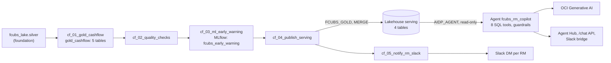

# Use case 01: Cash-flow intelligence

**Status:** available. **Builds on:** the shared foundation (bronze, silver, serving users).
**Business owners:** retail and SME relationship management, collections, credit risk.

FLEXCUBE already records when a salary stops arriving, when an SME's receipts fall, when balances drain and when instalments
slip. This module turns those signals into action before arrears or attrition happen, and explains every flag in plain
language.

| Capability | Question it answers | Delivered as |
|---|---|---|
| Early warning (rules plus ML) | Which customers are heading for distress or about to leave, and why? | Risk band and reasons per customer; ML probability of 30+ days past due and of attrition in 90 days, with the model's own reasons |
| Smart collections | Who should collections call first today, and who can we help before they miss a payment? | Ranked worklist with a recommended action |
| SME cash flow | How is this business doing, and how many months of runway does it have? | Monthly receipts, payments, payroll, balance and runway |
| RM copilot | All of the above in plain language | AIDP agent with 8 read-only SQL tools and guardrails, in Agent Hub, through its `/chat` API or in Slack |
| Daily RM alert | What does each RM need to act on this morning? | One direct message per RM, audited |

**Results on the sample bank:** 9 of 9 planted SME revenue drops and 34 of 37 job losses flagged, 0 HIGH false alarms among
1,818 normal customers; the attrition model is more than twice as precise as the rules alone ([results](docs/05_results.md)).

## Architecture

## Enable the module

Prerequisite: [foundation deployed](../../docs/foundation/02_deploy.md) through step 6, so silver passes its checks and the
serving users and catalogs exist.

| Step | Do | Chapter |
|---|---|---|
| 1 | Serving tables: `bash foundation/serving/deploy_serving_layer.sh <Lakehouse OCID> 01-cashflow-intelligence` (skip if you deployed all modules in foundation step 6) | [3](docs/03_serving_and_agent.md) |
| 2 | Import [`notebooks/`](notebooks) and run `cf_01_gold_cashflow`, then `cf_02_quality_checks` | [1](docs/01_gold_and_rules.md) |
| 3 | Create experiment `fcubs_early_warning`, run `cf_03_ml_early_warning`, register the best runs | [2](docs/02_ml_early_warning.md) |
| 4 | Run `cf_04_publish_serving` | [3](docs/03_serving_and_agent.md) |
| 5 | Build, test and deploy the agent from [`agent/fcubs_rm_copilot.md`](agent/fcubs_rm_copilot.md) | [3](docs/03_serving_and_agent.md) |
| 6 | Optional: daily RM alert and copilot in Slack | [4](docs/04_rm_alerts_and_slack.md) |
| 7 | Add the module to the workflow: `cf_01_gold_cashflow > cf_02_quality_checks > cf_03_ml_early_warning > cf_04_publish_serving > cf_05_notify_rm_slack`, after `fnd_03_quality_checks` | [foundation step 8](../../docs/foundation/02_deploy.md#step-8-daily-workflow) |

## What it adds

| Layer | Objects |
|---|---|
| FLEXCUBE tables used | The foundation's 15 tables; nothing extra |
| Gold (`fcubs_lake.gold_cashflow`) | `customer_monthly_cashflow`, `cashflow_features`, `early_warning`, `collections_priority`, `sme_cashflow`, `ml_feature_panel`, `ml_early_warning`, `rm_directory`, `rm_alert_log` |
| ML | Experiment `fcubs_early_warning`; models `fcubs_ews_arrears_90d`, `fcubs_ews_attrition_90d` |
| Serving (`FCUBS_GOLD`) | `EARLY_WARNING`, `COLLECTIONS_PRIORITY`, `SME_CASHFLOW`, `ML_EARLY_WARNING` ([`sql/`](sql)) |
| Agent | `fcubs_rm_copilot` on AI compute `fcubs_ai` |
| Channels | Slack DM per RM (notebook); copilot in Slack ([`channels/slack`](../../channels/slack)) |

## Playbook

1. [Gold layer, early-warning rules and collections](docs/01_gold_and_rules.md)
2. [ML early warning with MLflow](docs/02_ml_early_warning.md)
3. [Serving layer and RM copilot agent](docs/03_serving_and_agent.md)
4. [Daily RM alerts and the copilot in Slack](docs/04_rm_alerts_and_slack.md)
5. [Results and validation](docs/05_results.md)
6. [Troubleshooting](docs/06_troubleshooting.md)

## Remove the module

Delete the workflow tasks, undeploy and delete the agent, drop the 4 serving tables and schema `fcubs_lake.gold_cashflow`,
and delete the experiment and registered models. The foundation and other modules are unaffected.
