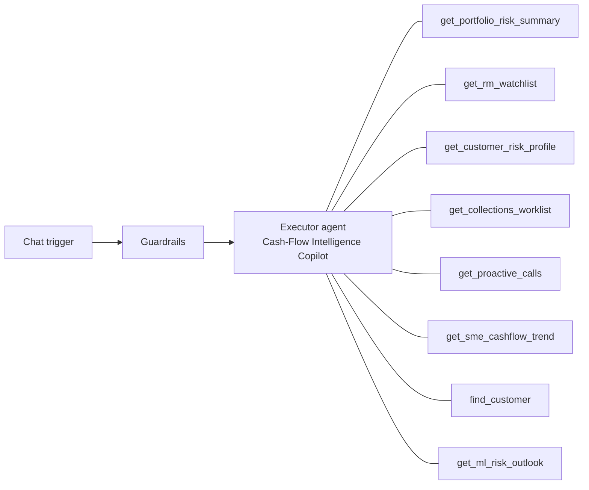

# 3. Serving layer and RM copilot agent

## Serving tables

Agent SQL tools query Oracle databases through external catalogs, while gold is Delta. `cf_04_publish_serving` merges four
curated tables into the serving schema `FCUBS_GOLD` in the AIDP Lakehouse. The agent reads them through `AIDP_AGENT`
(SELECT only) and never sees bronze, silver or raw FLEXCUBE.

| Serving table | Primary key | From |
|---|---|---|
| `EARLY_WARNING` | as_of_date, customer_no | gold `early_warning` plus names |
| `COLLECTIONS_PRIORITY` | as_of_date, loan_no | gold `collections_priority` |
| `SME_CASHFLOW` | customer_no, month_start | gold `sme_cashflow` |
| `ML_EARLY_WARNING` | as_of_date, customer_no | gold `ml_early_warning`, including `ML_DRIVERS` |

Each run's as-of date is kept, so history accumulates and re-runs are safe.

1. **Tables:** created by `foundation/serving/deploy_serving_layer.sh` from [`sql/01_cashflow_serving_tables.sql`](../sql/01_cashflow_serving_tables.sql)
   (console alternative: run the file as ADMIN in the Lakehouse's Database Actions, after `foundation/serving/sql/00_serving_users.sql`).
2. **Catalogs:** refresh `fcubs_serving_rw` and `fcubs_serving` until the 4 tables appear.
3. **Publish:** run `cf_04_publish_serving`. Sample: early_warning 2,000, collections_priority 109, sme_cashflow 3,900,
   ml_early_warning about 1,942.

## AI compute

Workspace > Compute > **AI Compute** > Create `fcubs_ai`, default size.

## The agent

Workspace > Agents > Create `fcubs_rm_copilot` on `fcubs_ai`. Everything to paste is in
[`agent/fcubs_rm_copilot.md`](../agent/fcubs_rm_copilot.md).

1. **Agent node** (Executor): paste the instructions (20 rules).
2. **Model:** OCI Generative AI, an on-demand chat model with tool calling (tested with `cohere.command-a-03-2025`). Max output
   tokens 3000, temperature 0.2, top p 0.7, seed 42, penalties 0, preamble override empty. **Safety mode:** empty or exactly
   `CONTEXTUAL` in capitals; the field is free text and any other spelling makes every question fail.
3. **Memory:** on, last 20 messages, 3 tool outputs per tool.
4. **8 SQL tools** on catalog `fcubs_serving`, schema `fcubs_gold`, Oracle dialect, max rows 50, each connected to the agent
   node only. Quote every parameter in SQL (`'{{rm_id}}'`), and give every parameter a description and a default (`ALL` where
   sensible) so follow-up questions that pass fewer parameters still work.
5. **Guardrails** between the trigger and the agent: PII input Address, Telephone, Email = Mask, Person off; PII output Person
   off, **Telephone = Allow** (otherwise amounts such as 61,673.78 are masked), Address and Email = Mask; content moderation
   Block on input and output; prompt injection Block on input.
6. **Test** in the Playground, always in a new session after a change, and read the trace (tool, parameters, SQL, errors).
7. **Deploy** on `fcubs_ai`, 1 replica; grant use under Permissions. Business users chat in **Agent Hub**; applications use the
   deployment's `/chat` endpoint (OCI-signed). Redeploy after every change.

## Demo script

| # | Ask | Tool | Shows |
|---|---|---|---|
| 1 | "How is the portfolio looking this morning?" | 1 | Counts by risk band and signal |
| 2 | "Who should collections call first today?" | 4 | Ranked worklist |
| 3 | "Who can we help before they miss a payment?" | 5 | Proactive calls before arrears start |
| 4 | "Why is Daniel Hughes flagged?" | 7 then 3 | Reasons in plain language |
| 5 | "I'm RM014. Which of my customers are at risk?" | 2 | Personal watchlist |
| 6 | "How is Sapphire Stone General Trading LLC doing? How much runway?" | 7 then 6 | Receipts down about 65 percent since May |
| 7 | "Which customers is the model worried about that the rules have not flagged?" then "Why?" | 8 | ML-only early signs with the model's reasons |
| 8 | "Rank my at-risk customers by nationality." | none | Refusal: no protected attributes |

Names are from the synthetic sample bank. Latency is typically 6 to 25 seconds per answer on an on-demand model.

**Known behaviour:** Cohere Command A adds a short "tool plan" sentence before tool calls, which AIDP joins to the answer.
Accept it as transparency, try another on-demand model, or strip it in the calling application (the Slack bridge does).
